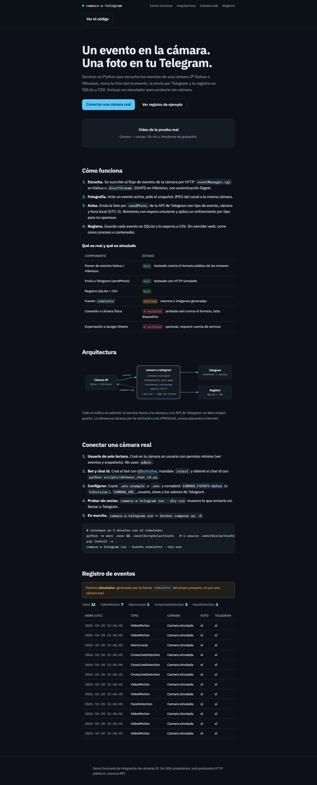
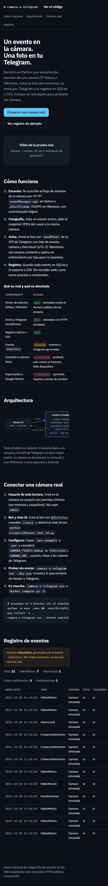
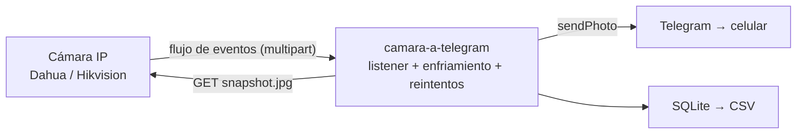

# camara-a-telegram

**Evento de cámara IP → foto en Telegram → registro.** Servicio en Python 3.12
que escucha los eventos de una cámara Dahua o Hikvision por HTTP (Digest +
flujo multipart), toma el snapshot del canal, lo envía a Telegram con
`sendPhoto` y lo registra en SQLite/CSV. Trae un **simulador** para probar
todo sin cámara. Sin SDK propietarios: solo protocolos públicos.

> English summary: a small Python service that listens to Dahua/Hikvision IP
> camera events over their public HTTP interfaces, snapshots the channel,
> sends the photo to a Telegram chat via `sendPhoto`, and logs everything to
> SQLite/CSV. Ships with a simulator so the whole pipeline can be tested and
> demoed without a camera. MIT licensed.

## Capturas del sitio (reales)

Sitio publicado en GitHub Pages: https://esvindal.github.io/camara-a-telegram/




## Arranque en 5 minutos (simulador, sin Telegram)

```bash
python -m venv .venv
.venv\Scripts\activate        # Windows — en Linux/Mac: source .venv/bin/activate
pip install -e ".[dev]"
camara-a-telegram run --fuente simulator --dry-run
```

`--dry-run` imprime por log lo que enviaría (caption + tamaño de foto) sin
llamar a Telegram ni a ninguna cámara.

## Uso con Telegram real

1. Crear el bot con [@BotFather](https://t.me/BotFather) y guardar el token.
2. Mandarle `/start` al bot desde tu cuenta.
3. Obtener el chat id: `python scripts/obtener_chat_id.py`
4. Copiar `.env.example` a `.env` y completar `TELEGRAM_TOKEN` y
   `TELEGRAM_CHAT_ID`.
5. `camara-a-telegram run --fuente simulator` (o `dahua` / `hikvision`).

## Uso con una cámara real

```env
CAMARA_FUENTE=dahua            # o hikvision
CAMARA_URL=http://192.168.1.64
CAMARA_USUARIO=usuario_solo_lectura
CAMARA_CLAVE=clave
```

- **Dahua**: eventos por `GET /cgi-bin/eventManager.cgi?action=attach&codes=[All]&heartbeat=5`
  (stream `multipart/x-mixed-replace`) y foto por `GET /cgi-bin/snapshot.cgi?channel=N`.
- **Hikvision**: eventos por `GET /ISAPI/Event/notification/alertStream`
  (stream `multipart/mixed` con XML `EventNotificationAlert`) y foto por
  `GET /ISAPI/Streaming/channels/{canal}01/picture`.

Endpoints verificados contra la especificación HTTP pública de Dahua/Amcrest,
la especificación ISAPI de Hikvision y proyectos comunitarios
([rroller/dahua](https://github.com/rroller/dahua),
[pyHik](https://github.com/mezz64/pyHik),
[Telegram Bot API](https://core.telegram.org/bots/api#sendphoto)). Los
firmwares varían entre modelos: verificá contra tu equipo antes de producción.

## Arquitectura



## Comandos

| Comando | Qué hace |
|---|---|
| `camara-a-telegram run` | Escucha eventos y notifica. Flags: `--fuente`, `--intervalo`, `--max-eventos`, `--enfriamiento`, `--dry-run` |
| `camara-a-telegram exportar-csv` | Exporta el registro SQLite a CSV |
| `camara-a-telegram generar-datos` | Genera `docs/data/eventos-ejemplo.json` con el simulador (alimenta el sitio `docs/`) |

## Docker

```bash
docker compose up -d --build
```

Imagen multi-etapa, corre como usuario no-root, monta `./datos` para la base
SQLite y toma la configuración de `.env`. Solo tráfico saliente.

## Qué es real y qué es simulado

| Componente | Estado |
|---|---|
| Parser de eventos Dahua / Hikvision | **Real** — testeado contra el formato público de los streams |
| Envío a Telegram (`sendPhoto`) | **Real** — testeado con HTTP simulado (respx) |
| Registro SQLite + exportación CSV/JSON | **Real** |
| Fuente `simulator` | **Simulada** — eventos e imágenes generadas, marcados como "datos de ejemplo" |
| Conexión a cámara física | **A verificar en dispositivo** — los parsers siguen el formato público; falta la corrida contra hardware |
| Google Sheets | **A verificar** — opcional (extra `[sheets]`), requiere cuenta de servicio |
| Webcam como fuente de foto | **A verificar** — opcional (extra `[webcam]`), depende del equipo |

## Limitaciones honestas

- El stream de eventos depende del firmware: algunos modelos agregan campos
  o heartbeats distintos. Las partes irreconocibles se descartan, no rompen.
- El modo Hikvision asume canales de streaming `N01` (canal 1 → 101). NVRs con
  numeración distinta necesitan ajustar `snapshot()`.
- Sin reconexión infinita garantizada: reconecta con espera fija (5 s) ante
  errores HTTP del stream.
- Las fotos de eventos pueden contener rostros o patentes: **datos
  personales**. Revisá la normativa de tu jurisdicción antes de reenviarlas a
  servicios de terceros.

## Seguridad

- Usá siempre un usuario de **solo lectura** en la cámara, nunca `admin`.
- La cámara no se expone a Internet: el servicio solo hace llamadas salientes;
  alcanzala por la red local, VPN o túnel.
- Las credenciales viven en `.env` (ignorado por git). Los logs nunca incluyen
  contraseñas ni el token del bot.
- El `.env.example` no contiene valores reales.

## Desarrollo

```bash
pip install -e ".[dev]"
pytest          # tests con HTTP simulado, sin red
ruff check src tests
mypy
```

## Estructura

```
src/camara_telegram/
  fuentes/      interfaz común + simulator / dahua / hikvision
  destinos/     telegram / consola (dry-run) / sheets (opcional)
  almacen/      registro SQLite + exportación CSV/JSON
  multipart.py  partidor incremental de multipart/x-mixed-replace
  pipeline.py   evento → foto → caption → destino → registro
docs/           sitio del proyecto (GitHub Pages)
demo/GRABACION.md  guion del video de la prueba real
scripts/obtener_chat_id.py
```

Licencia MIT. Hecho como demo funcional de portafolio: lo simulado está
siempre marcado.
